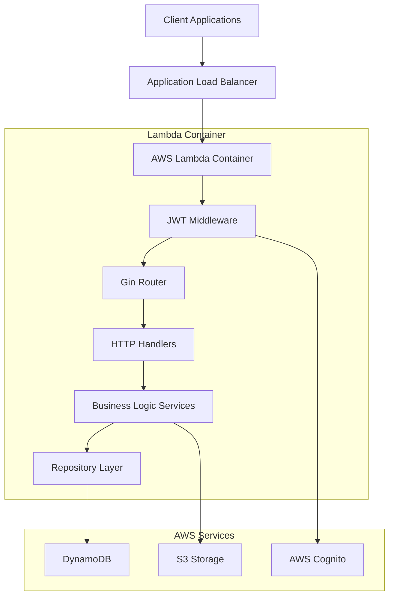
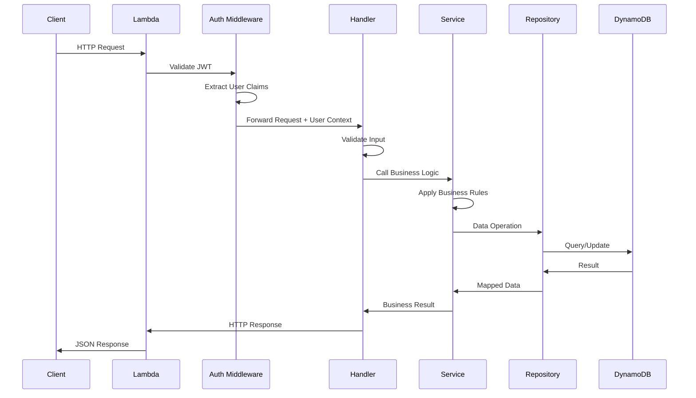
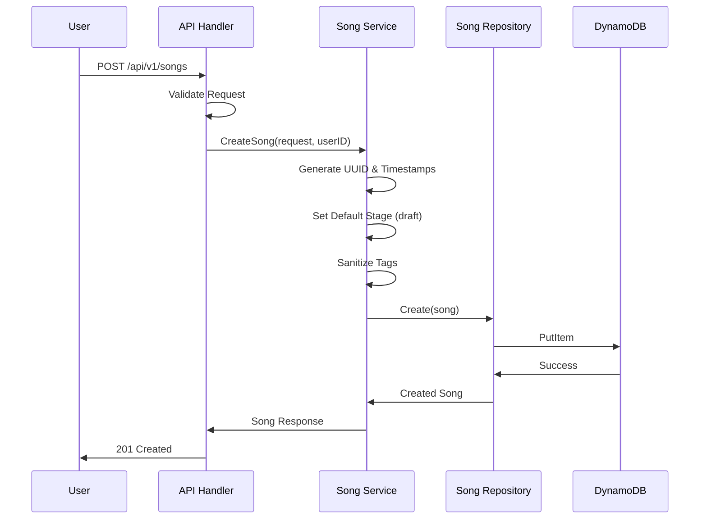
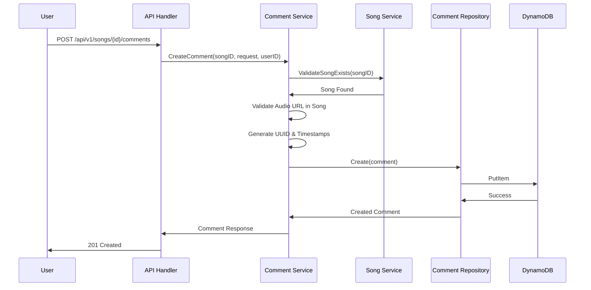
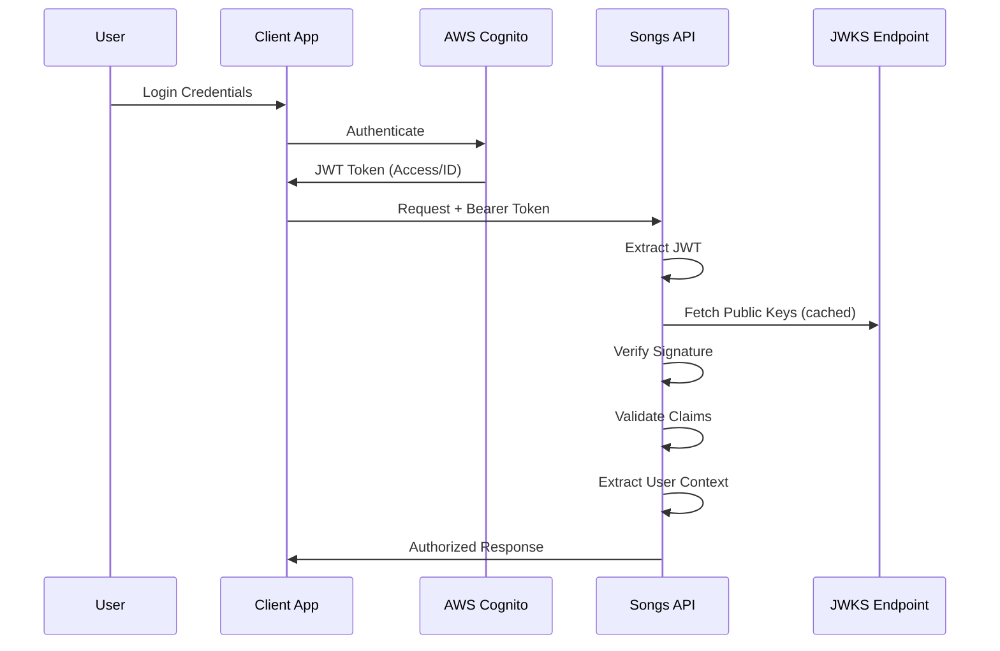

# Songs Backend API - System Architecture

This document provides a comprehensive overview of the Songs Backend API
architecture, design patterns, data flow, and system components. The
application is built with Go 1.22 and follows modern serverless patterns with
AWS services.

## Table of Contents

- [System Overview](#system-overview)
- [Architecture Principles](#architecture-principles)
- [Technology Stack](#technology-stack)
- [System Components](#system-components)
- [Data Flow](#data-flow)
- [Design Patterns](#design-patterns)
- [Database Design](#database-design)
- [Security Architecture](#security-architecture)
- [Performance Considerations](#performance-considerations)
- [Scalability & Reliability](#scalability--reliability)

## System Overview

The Songs Backend API is a serverless REST API designed for managing songs
and comments with stage support. The architecture follows hexagonal
architecture principles with clean separation of concerns.



### High-Level Architecture

```text
┌─────────────────────┐     ┌─────────────────────┐     ┌─────────────────────┐
│   Client Layer      │────▶│   API Gateway       │────▶│   Compute Layer     │
│                     │     │   (Load Balancer)   │     │   (Lambda)          │
│ - Web Apps          │     │ - HTTPS Termination │     │ - Gin Framework     │
│ - Mobile Apps       │     │ - Request Routing   │     │ - Business Logic    │
│ - API Clients       │     │ - Rate Limiting     │     │ - Data Validation   │
└─────────────────────┘     └─────────────────────┘     └─────────────────────┘
                                                                    │
                            ┌─────────────────────┐                │
                            │   Authentication    │◀───────────────┘
                            │                     │
                            │ - AWS Cognito       │
                            │ - JWT Validation    │
                            │ - JWKS Refresh      │
                            └─────────────────────┘
                                                                    │
┌─────────────────────┐     ┌─────────────────────┐     ┌─────────────────────┐
│   Data Layer        │◀────│   Storage Layer     │◀────│   Service Layer     │
│                     │     │                     │     │                     │
│ - DynamoDB          │     │ - Repository        │     │ - Song Service      │
│   * Songs Table     │     │   Pattern           │     │ - Comment Service   │
│   * Comments Table  │     │ - S3 Integration    │     │ - Media Service     │
│ - S3 Bucket         │     │ - Data Mapping      │     │ - Business Rules    │
│   * Media Files     │     │ - Query Optimization│     │ - Validation        │
└─────────────────────┘     └─────────────────────┘     └─────────────────────┘
```

## Architecture Principles

### 1. Clean Architecture

- **Separation of Concerns**: Clear boundaries between presentation, business
  logic, and data layers
- **Dependency Inversion**: High-level modules don't depend on low-level modules
- **Single Responsibility**: Each component has one reason to change

### 2. Serverless-First Design

- **Event-Driven**: Lambda functions triggered by HTTP requests
- **Managed Services**: Leveraging AWS managed services (DynamoDB, S3, Cognito)
- **Auto-Scaling**: Automatic scaling based on demand

### 3. API-First Development

- **Contract-First**: OpenAPI specification defines the contract
- **RESTful Design**: Following REST principles and HTTP standards
- **Consistent Responses**: Standardized error and success response formats

### 4. Security by Design

- **Authentication**: JWT-based authentication with AWS Cognito
- **Authorization**: Resource-level access control
- **Data Isolation**: User data segregation at the application level

## Technology Stack

### Core Technologies

```yaml
Language: Go 1.22
Framework: Gin (HTTP router/middleware)
Runtime: AWS Lambda (Container runtime)
Authentication: AWS Cognito (JWT)
Database: AWS DynamoDB (NoSQL)
Storage: AWS S3 (Object storage)
Validation: go-playground/validator
Containerization: Docker (multi-stage build)
```

### Key Dependencies

```yaml
AWS SDK v2:
  - aws-sdk-go-v2/config
  - aws-sdk-go-v2/service/dynamodb
  - aws-sdk-go-v2/service/s3
  
JWT Handling:
  - golang-jwt/jwt/v5
  - MicahParks/keyfunc/v2
  
HTTP & Middleware:
  - gin-gonic/gin
  - awslabs/aws-lambda-go-api-proxy
  
Utilities:
  - google/uuid
  - go-playground/validator/v10
```

## System Components

### 1. Entry Point (`cmd/api/main.go`)

The application entry point that:

- Loads configuration from environment variables
- Initializes AWS service clients
- Creates dependency injection container
- Determines runtime environment (Lambda vs local)

```go
// Simplified structure
func main() {
    cfg := config.Load()
    awsCfg := loadAWSConfig(cfg.AWSRegion)
    
    deps := &server.Dependencies{
        Config:       cfg,
        DynamoClient: dynamodb.NewFromConfig(awsCfg),
        S3Client:     s3.NewFromConfig(awsCfg),
    }
    
    if cfg.IsLambda {
        // Lambda runtime
        lambda.Start(ginAdapter.ProxyWithContext)
    } else {
        // Local development
        server.Run(deps.Config.Port)
    }
}
```

### 2. Configuration Layer (`internal/config/`)

Centralized configuration management with:

- Environment variable loading
- Default value handling
- Required variable validation
- Development/production mode detection

### 3. HTTP Server Layer (`internal/server/`)

HTTP request handling with:

- Gin router setup and middleware configuration
- Route definition and grouping
- CORS handling
- Request/response logging
- Panic recovery

### 4. Middleware Layer (`internal/middleware/`)

Cross-cutting concerns:

```go
// JWT Authentication Middleware
type JWTMiddleware struct {
    jwksURL      string
    userPoolID   string
    audience     string
    keyFunc      keyfunc.Keyfunc
}

// Validates JWT tokens and extracts user claims
func (m *JWTMiddleware) Middleware() gin.HandlerFunc {
    return gin.HandlerFunc(func(c *gin.Context) {
        token := extractBearerToken(c)
        claims, err := m.validateJWT(token)
        if err != nil {
            c.AbortWithStatusJSON(401, ErrorResponse{...})
            return
        }
        c.Set("user_id", claims.Subject)
        c.Next()
    })
}
```

### 5. Service Layer (`internal/service/`)

Business logic implementation:

#### Song Service

- Song CRUD operations
- Stage categorization
- User authorization checks
- Media URL management

#### Comment Service

- Comment CRUD operations
- Song association validation
- User ownership validation

#### Media Service

- S3 presigned URL generation
- File type validation
- User-based file organization

### 6. Repository Layer (`internal/repository/`)

Data access abstraction:

```go
type SongRepository interface {
    Create(ctx context.Context, song *models.Song) error
    GetByID(ctx context.Context, id, userID string) (*models.Song, error)
    Update(ctx context.Context, song *models.Song) error
    Delete(ctx context.Context, id, userID string) error
    ListByUser(ctx context.Context, userID string, opts ListOptions) \
        ([]models.Song, error)
    ListPublished(ctx context.Context, opts ListOptions) \
        ([]models.Song, error)
    Search(ctx context.Context, query string, opts SearchOptions) \
        ([]models.Song, error)
}
```

### 7. Storage Layer (`internal/storage/`)

S3 operations:

- Presigned URL generation for upload/download
- File metadata management
- User-based folder structure
- File type validation

### 8. Models Layer (`internal/models/`)

Data structures and domain logic:

- Song and Comment entities
- Request/Response DTOs
- Validation rules
- Business rules

## Data Flow

### 1. Request Processing Flow



### 2. Song Creation Flow



### 3. Comment Creation Flow



## Design Patterns

### 1. Repository Pattern

Abstracts data access logic and provides a consistent interface for data operations.

```go
// Repository interface defines the contract
type SongRepository interface {
    Create(ctx context.Context, song *models.Song) error
    GetByID(ctx context.Context, id, userID string) (*models.Song, error)
    // ... other methods
}

// DynamoDB implementation
type dynamoSongRepository struct {
    client    *dynamodb.Client
    tableName string
}

// Allows for easy testing with mock implementations
type mockSongRepository struct {
    songs map[string]*models.Song
}
```

### 2. Dependency Injection

Services receive their dependencies through constructors, making testing and
maintenance easier.

```go
type SongService struct {
    songRepo    repository.SongRepository
    commentRepo repository.CommentRepository
}

func NewSongService(songRepo repository.SongRepository, \
    commentRepo repository.CommentRepository) *SongService {
    return &SongService{
        songRepo:    songRepo,
        commentRepo: commentRepo,
    }
}
```

### 3. Middleware Pattern

Cross-cutting concerns are handled through middleware chain.

```go
router.Use(gin.Logger())
router.Use(gin.Recovery())
router.Use(corsMiddleware())

protected := router.Group("/api/v1")
protected.Use(jwtMiddleware.Middleware())
```

### 4. Strategy Pattern

Different storage backends can be implemented using the same interface.

```go
type StorageService interface {
    GenerateUploadURL(key string, contentType string) (string, error)
    GenerateDownloadURL(key string) (string, error)
    DeleteFile(key string) error
}

// S3 implementation
type S3StorageService struct { /* ... */ }

// Could add other implementations (Google Cloud Storage, etc.)
```

### 5. Builder Pattern

Complex object creation is handled through builders.

```go
func NewSong(req CreateSongRequest, userID string) *Song {
    now := time.Now().UTC().Format(time.RFC3339)
    
    return &Song{
        ID:          uuid.New().String(),
        Title:       strings.TrimSpace(req.Title),
        Stage:       getStageOrDefault(req.Stage),
        Tags:        sanitizeTags(req.Tags),
        UserID:      userID,
        CreatedAt:   now,
        UpdatedAt:   now,
    }
}
```

## Database Design

### DynamoDB Table Structure

#### Songs Table

```yaml
Table: songs-{environment}
Partition Key: id (String) - Song UUID
Attributes:
  - id: Song UUID
  - title: Song title
  - subtitle: Optional subtitle
  - description: Song description
  - image_urls: Array of S3 URLs
  - audio_urls: Array of S3 URLs
  - lyrics: Song lyrics text
  - stage: Song stage (draft|review|published|archived)
  - tags: Array of tags for categorization
  - user_id: Owner's user ID
  - created_at: ISO 8601 timestamp
  - updated_at: ISO 8601 timestamp

Global Secondary Indexes:
  - UserIndex: user_id (PK), created_at (SK)
  - StageIndex: stage (PK), created_at (SK)
  - TagIndex: tags (PK), created_at (SK) [for tag-based queries]
```

#### Comments Table

```yaml
Table: comments-{environment}
Partition Key: id (String) - Comment UUID
Attributes:
  - id: Comment UUID
  - song_id: Associated song UUID
  - audio_url: Specific audio file URL being commented on
  - content: Comment text (max 2000 chars)
  - user_id: Comment author's user ID
  - created_at: ISO 8601 timestamp
  - updated_at: ISO 8601 timestamp

Global Secondary Indexes:
  - SongIndex: song_id (PK), created_at (SK)
  - UserIndex: user_id (PK), created_at (SK)
  - AudioIndex: audio_url (PK), created_at (SK)
```

### Data Access Patterns

#### Songs

```sql
-- Get song by ID (user must own it)
GetItem: PK=song_id, FilterExpression: user_id = :user_id

-- List user's songs
Query: GSI=UserIndex, PK=user_id, SortKey=created_at

-- List published songs (public)
Query: GSI=StageIndex, PK=published, SortKey=created_at

-- Search by tags
Query: GSI=TagIndex, PK=tag_value, SortKey=created_at
```

#### Comments

```sql
-- Get comment by ID
GetItem: PK=comment_id

-- List song comments
Query: GSI=SongIndex, PK=song_id, SortKey=created_at

-- List user's comments
Query: GSI=UserIndex, PK=user_id, SortKey=created_at

-- List comments for specific audio file
Query: GSI=AudioIndex, PK=audio_url, SortKey=created_at
```

## Security Architecture

### 1. Authentication Flow



### 2. Authorization Model

#### Resource Ownership

- **Songs**: Users can only access songs they created
- **Comments**: Users can create comments on any published song, but only
  modify/delete their own comments
- **Media Files**: Users can only access files they uploaded

#### Permission Matrix

```yaml
Resource: Songs
  - Create: Authenticated users
  - Read (Own): Song owner
  - Read (Public): Published songs only
  - Update: Song owner (if not archived)
  - Delete: Song owner

Resource: Comments
  - Create: Authenticated users (on published songs)
  - Read: Song is published OR user owns song OR user owns comment
  - Update: Comment owner
  - Delete: Comment owner

Resource: Media
  - Upload: Authenticated users
  - Download: File owner or song is published
  - Delete: File owner
```

### 3. Data Isolation

- User ID is embedded in all database queries
- S3 file paths include user ID prefix: `{type}/{user-id}/{file-id}.{ext}`
- No cross-user data access at the application level

### 4. Input Validation & Sanitization

```go
type CreateSongRequest struct {
    Title       string   `json:"title" validate:"required,min=1,max=255"`
    Description string   `json:"description" validate:"max=2000"`
    Tags        []string `json:"tags" validate:"max=20,dive,min=1,max=50"`
}

// Sanitization functions
func sanitizeTags(tags []string) []string {
    // Remove duplicates, trim whitespace, convert to lowercase
}

func sanitizeContent(content string) string {
    // Trim whitespace, normalize line endings
}
```

## Performance Considerations

### 1. Lambda Cold Start Optimization

```dockerfile
# Multi-stage build for minimal image size
FROM golang:1.22-alpine AS builder
RUN CGO_ENABLED=0 GOOS=linux GOARCH=amd64 go build \
    -tags lambda.norpc \
    -ldflags="-s -w" \
    -o main \
    cmd/api/main.go

FROM public.ecr.aws/lambda/provided:al2023
COPY --from=builder /app/main ./main
```

### 2. DynamoDB Optimization

- **GSI Strategy**: Global Secondary Indexes for common query patterns
- **Batch Operations**: Use BatchGetItem and BatchWriteItem where possible
- **Projection**: Only project required attributes in GSIs
- **Pagination**: Implement cursor-based pagination with LastEvaluatedKey

### 3. S3 Optimization

- **Presigned URLs**: Reduce API server load for file operations
- **Multipart Upload**: For large files (>5MB)
- **CDN Integration**: CloudFront for frequently accessed files
- **Lifecycle Policies**: Automated cleanup of unused files

### 4. Caching Strategy

```go
// JWT Key caching
type JWTMiddleware struct {
    keyFunc   keyfunc.Keyfunc  // Caches JWKS keys
    refresher *keyfunc.RefreshHandler
}

// DynamoDB connection pooling
var dynamoClient = dynamodb.NewFromConfig(cfg) // Reused across requests
```

## Scalability & Reliability

### 1. Auto-Scaling

- **Lambda Concurrency**: Automatic scaling based on request volume
- **DynamoDB**: On-demand billing with auto-scaling
- **S3**: Virtually unlimited storage capacity

### 2. Error Handling

```go
// Structured error responses
type ErrorResponse struct {
    Error     string                 `json:"error"`
    Status    int                   `json:"status"`
    Path      string                `json:"path"`
    Method    string                `json:"method"`
    Timestamp string                `json:"timestamp"`
    Details   map[string]interface{} `json:"details,omitempty"`
}

// Panic recovery middleware
router.Use(gin.Recovery())

// Graceful error handling
func (h *Handler) handleError(c *gin.Context, err error, status int) {
    response := ErrorResponse{
        Error:     err.Error(),
        Status:    status,
        Path:      c.Request.URL.Path,
        Method:    c.Request.Method,
        Timestamp: time.Now().UTC().Format(time.RFC3339),
    }
    c.JSON(status, response)
}
```

### 3. Monitoring & Observability

- **CloudWatch Logs**: Structured JSON logging
- **CloudWatch Metrics**: Lambda performance metrics
- **X-Ray Tracing**: Request tracing across services
- **Custom Metrics**: Business metrics (songs created, comments, etc.)

### 4. Reliability Patterns

- **Idempotency**: UUIDs prevent duplicate resource creation
- **Circuit Breaker**: For external service calls
- **Retry Logic**: With exponential backoff for AWS service calls
- **Health Checks**: `/health` endpoint for service monitoring

### 5. Data Consistency

- **Eventually Consistent**: DynamoDB reads for list operations
- **Strongly Consistent**: DynamoDB reads for single item operations
- **Optimistic Locking**: Using version fields for concurrent updates
- **Atomic Operations**: DynamoDB transactions for multi-item operations

## Deployment Architecture

### 1. Infrastructure as Code

```yaml
# CloudFormation/Terraform resources
- Lambda Function (Container)
- DynamoDB Tables (Songs, Comments)
- S3 Bucket (Media storage)
- IAM Roles & Policies
- CloudWatch Log Groups
- API Gateway (if used)
```

### 2. CI/CD Pipeline

```yaml
stages:
  - Test: go test ./...
  - Lint: golangci-lint run
  - Security: gosec ./...
  - Build: Docker build
  - Deploy: Push to ECR, Update Lambda
```

### 3. Environment Management

- **Development**: Local development with LocalStack
- **Staging**: AWS environment with test data
- **Production**: Production AWS environment with monitoring

This architecture provides a robust, scalable, and maintainable foundation
for the Songs Backend API, following Go best practices and AWS serverless
patterns.
